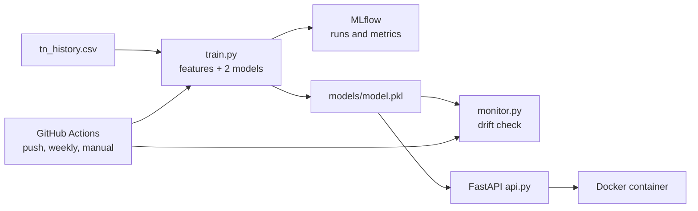

# Tamil Nadu Next-Day Peak Demand Forecasting (MLOps pipeline)

Predicts next-day peak electricity demand for Tamil Nadu from daily Grid-India
data (Jan 2020 to Mar 2025), and wraps the model in a reproducible,
containerised, monitored pipeline.

## Results (test set: Mar 2024 to Mar 2025)

| Method | MAPE |
|---|---|
| Naive (yesterday = tomorrow) | 5.54% |
| Linear Regression | 4.16% |
| **Random Forest (selected)** | **3.70%** |

Random Forest: MAE 617.9 MW, RMSE 845.1 MW.

## Pipeline



## Features

day of week, month, Tamil Nadu holiday flag, previous day's peak, 7-day rolling
average. Time-based 80/20 split (no shuffling) to avoid data leakage.

## Tools

Python, scikit-learn, MLflow (experiment tracking), DVC (dataset versioning),
FastAPI, Docker, GitHub Actions (retraining and drift check).

## Run it

```
pip install -r requirements.txt mlflow
python train.py          # trains, logs to MLflow, saves models/
python monitor.py        # drift check on the last 30 days
```

API in Docker:

```
docker build -t tn-demand-api .
docker run -p 8000:8000 tn-demand-api
```

Open http://127.0.0.1:8000/docs and call `POST /predict` with
`{"date": "2025-04-01", "prev_peak": 18916, "roll7": 18972}`.

## Drift monitoring

`monitor.py` compares the model's error on the most recent 30 days with its
test-set MAPE at training time. It raises an alert (exit code 1) if the recent
error is more than 1.5x the baseline. `python monitor.py --simulate-drift`
demonstrates the alert.

## Limitations

- Data ends on 2025-03-31, so the drift check is partly in-sample until new
  data is added.
- No weather features.
- Automatic download of new Grid-India data is future work.
